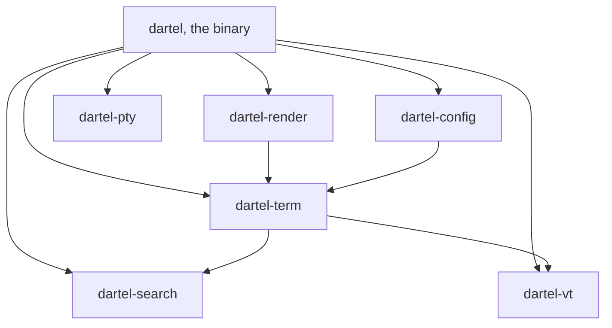
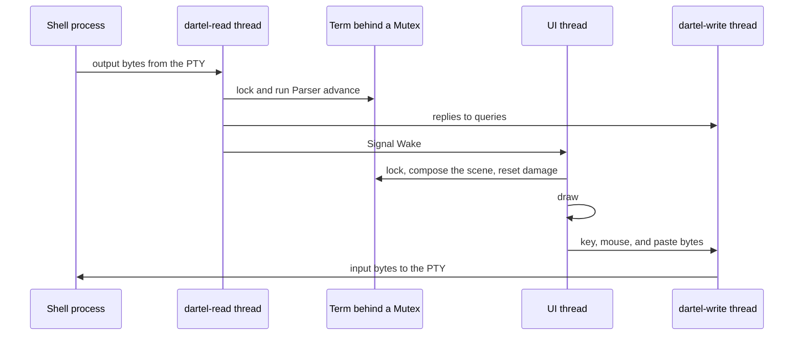
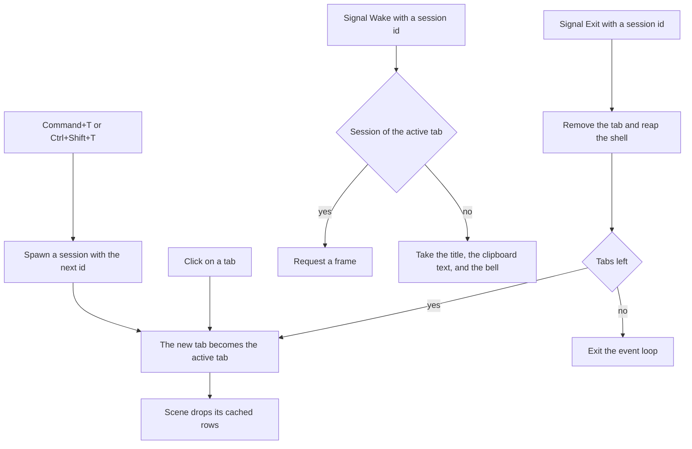
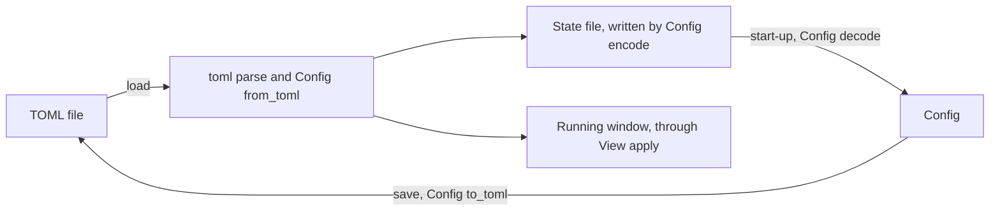
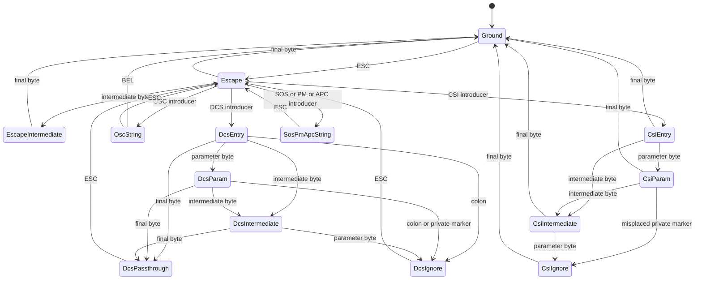
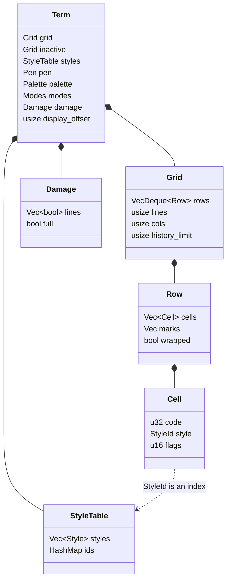
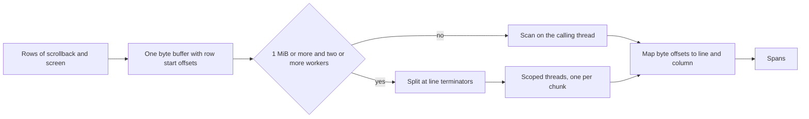
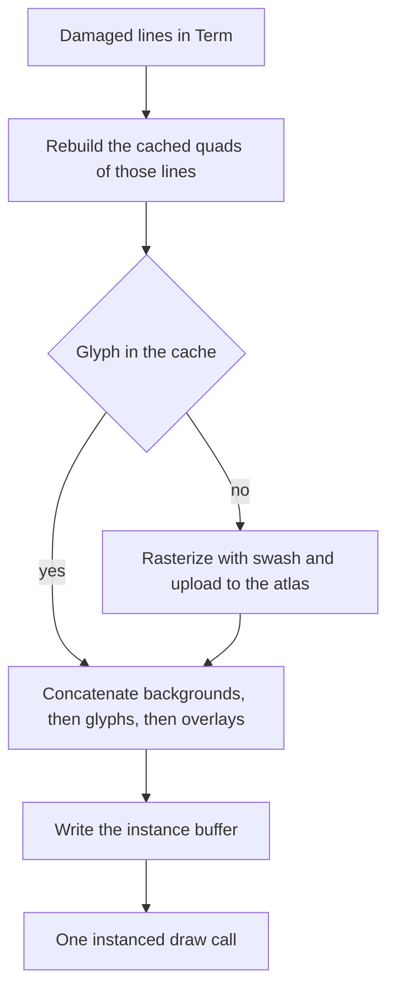

# Architecture

Dartel is a terminal emulator split into seven crates. Five library crates
turn the bytes a shell writes into terminal state and have no window or GPU
dependency. `dartel-render` draws that state with the GPU, and the `dartel`
binary owns the window, the tabs, and the input.

## Crates and modules

An arrow points from a crate to a crate it depends on.

| Crate | Modules | Responsibility |
| --- | --- | --- |
| `dartel-vt` | `lib`, `params`, `utf8`, `scan` | VT state machine that calls a `Perform` implementation, and the length of the leading run of printable ASCII with NEON, SSE2, and scalar implementations |
| `dartel-search` | `lib` | Literal and regex search over a byte buffer |
| `dartel-term` | `lib`, `cell`, `grid`, `row`, `screen`, `perform`, `sgr`, `osc`, `style`, `color`, `find`, `modes`, `charset` | Screen, scrollback, styles, modes, and the `Perform` implementation |
| `dartel-pty` | `lib` | PTY allocation, login shell spawn in the home directory, resize |
| `dartel-config` | `lib`, `toml` | Settings, the TOML parser, the saved state, and the file locations |
| `dartel-render` | `scene`, `font`, `gpu` | Conversion of terminal rows into quads, the tab bar, the glyph cache, font discovery and rasterization, the wgpu surface and draw call |
| `dartel` | `main`, `app`, `session`, `input`, `clipboard` | The `config` subcommands, winit event handling, tabs, selection, prompts, shortcuts, the threads around each PTY, key encoding, and the clipboard |

## Threads and data flow

Each tab owns one session, and one session runs three threads. The reader
thread parses output straight into the shared `Term`, so no byte is copied into
a channel between the PTY and the parser.

`Session` holds the state the threads share.

- `term` is the `Mutex<Term>`. The reader thread locks it for one read buffer
  at a time. The read buffer is 1 MiB.
- `frame_waiting` is set by the UI thread while it waits for the lock. The
  reader thread yields while the flag is set, so a flood of output cannot
  starve a frame.
- `wake_pending` collapses wake-ups. The reader thread sends `Signal::Wake`
  only when the flag was clear, and the UI thread clears it when it starts a
  frame.

The UI thread sleeps in `ControlFlow::Wait`. It switches to
`ControlFlow::WaitUntil` only while a cursor blink, a synchronized-update
timeout, or a notice is pending. A frame is skipped while the application
holds synchronized update mode, for at most 150 ms.

## Tabs

One window holds a list of tabs and draws the active one. A tab is a session
with its own title, selection, and search state. The window, the `Gpu`, and
the `Scene` are shared by all tabs.

- Every session has an id, and `Signal::Wake` and `Signal::Exit` carry it, so
  a signal finds its tab after other tabs have closed.
- A wake-up from a background tab draws no terminal content. The UI thread
  takes the title change, the clipboard request, and the bell from that `Term`
  and redraws only when the tab label changed.
- The tab bar is drawn while two or more tabs are open. It takes one cell
  height plus the padding at the top of the window, so opening the second tab
  and closing it resize every session.
- Every session is resized with the window, so a background tab has the right
  size when it becomes active.
- Closing a tab calls `Session::close`. The shell is reaped at once when it has
  exited, and on a `dartel-reap` thread otherwise.

## Settings

`dartel-config` holds the settings. The TOML file is read only when the user
asks for it, and the result is kept in a binary state file that start-up
decodes without parsing text.

- `toml::parse` is a single pass over the bytes of the input. Keys and
  unescaped strings borrow from the input. A table is a vector of entries in
  file order, and each entry records its line for error messages.
- The parser follows TOML 1.0 and reads tables, arrays of tables, dotted keys,
  inline tables, arrays, the four string forms, integers in four bases, floats,
  booleans, and date-times. A date-time is checked for its shape only and kept
  as text, so a month of 13 is accepted. Nesting is limited to 64 levels. The
  toml-test suite has not been run against the parser.
- `Config::from_toml` starts from the defaults and rejects an unknown key, a
  wrong type, and a value outside its range, each with the line number.
- `Config::encode` writes a magic that includes a format number, the fixed
  width fields in little-endian order, and the font family. `Config::decode`
  returns `None` for another magic, a short input, or a value outside its
  range, and start-up then uses the defaults.
- `Locations::resolve` places the TOML file under `XDG_CONFIG_HOME` and the
  state file under `XDG_STATE_HOME`, with `~/.config` and `~/.local/state` as
  fallbacks on both platforms.
- `save` and `load` are the only writers. The `dartel config save` and
  `dartel config load` subcommands and the two prompts in the window call the
  same functions.
- A load in the window rebuilds the `Scene` for the font and the padding, sets
  the palette of every `Term` through `Term::set_palette`, and resizes every
  session. The scrollback limit applies to tabs opened after the load, and the
  window size in cells applies at the next start.

## Parsing

`vt::Parser` is a byte-driven state machine. Most output is plain text, so the
`Ground` state has a bulk path. `scan::printable_run` returns the length of the
leading run of bytes in `0x20..=0x7E`, and the parser hands that whole run to
`Perform::print_ascii` in one call. The `OscString` state also copies its
payload in bulk. Every other state consumes one byte per step.

`CAN` and `SUB` return any state to `Ground`. `ESC` restarts a sequence from
any state.

UTF-8 is decoded by `vt::utf8`. An invalid sequence becomes one U+FFFD per
maximal subpart. A sequence cut by the end of a read buffer is kept in a
four-byte `pending` array and completed by the next `advance` call.

Limits keep hostile input bounded. A CSI sequence keeps 32 parameters and 2
intermediates. An OSC string keeps 16 parameters and 16 MiB of payload.

## Terminal state

- `Cell` is 8 bytes. It stores the code point, a `StyleId`, and flags for
  wide characters, the spacer cell after a wide character, and attached
  combining marks.
- `Row` stores combining marks outside the cells, as `(column, char)` pairs,
  with at most 8 marks per cell. `wrapped` records that the row continues on
  the next row.
- `Grid` is a `VecDeque<Row>`. The last `lines` rows are the screen and the
  rows before them are scrollback. When scrollback is full, the oldest row is
  popped and reused as the new blank row.
- `Term` owns two grids, one for the primary screen and one for the alternate
  screen. `grid` is whichever is active and `inactive` is the other, and
  switching screens swaps them. The alternate grid keeps no scrollback.
- `StyleTable` interns each distinct `Style`. The key packs the three colors
  and the attributes into a `u128`. A `StyleId` is a `u16`, and when the table
  is full, `Term` rebuilds it from the styles that cells still reference.
- `Pen` defers interning. SGR sequences only change `pen.style`, and the style
  is interned when the next character is written.
- `Damage` marks the lines a frame has to rebuild. Scrolling the view or
  resizing sets `full`.

Printable ASCII takes a short path through `Term::write_ascii`. While insert
mode is off and the active character set is ASCII, a run is copied into the
row in one loop per line without a width lookup. Other characters go through
`Term::write_char`, which handles width, wide characters at the right margin,
and combining marks.

Resizing rewraps the primary screen when the column count changes. Rows joined
by `wrapped` are merged into logical lines and split again at the new width,
and the cursor follows its cell. The alternate screen is truncated or padded
instead, because full-screen applications redraw it themselves.

## Search

`Term::search` flattens scrollback and screen into one byte buffer. A row that
is not `wrapped` ends with `\n`, so a match can cross a soft wrap and cannot
cross a hard line break. Byte offsets of matches are mapped back to line and
column, which accounts for wide characters and combining marks.

`search::Query` picks its engine once. A query with no regex metacharacter
and no case folding uses `memchr::memmem::Finder`. Everything else compiles to
`regex::bytes::Regex` in multi-line mode. Smart case folds only when the query
has no uppercase letter.

## Rendering

`Scene` converts rows into `Quad` instances. A `Quad` is 20 bytes and holds a
pixel rectangle, an atlas origin, and a color. The whole frame is one
instanced draw call over a four-vertex triangle strip.

- `Scene` caches the background quads and glyph quads of each line. A frame
  rebuilds only the lines that `Damage` reports.
- Overlays are appended after the cached quads on every frame. They are search
  matches, the selection, the cursor, the banner on the last line, the IME
  preedit text, and the tab bar. The banner shows the search prompt, a settings
  prompt, or a notice, and keeps the end of a text that is wider than the
  window.
- The cached quads of the lines start below the tab bar. Showing or hiding the
  bar marks every line stale.
- The glyph atlas is one 2048 by 2048 RGBA texture filled shelf by shelf. When
  it is full, the glyph cache is dropped and the visible lines are rasterized
  again.
- Glyphs for ASCII are cached in an array indexed by face and byte. Other
  glyphs are cached in a `HashMap` keyed by character and face.
- `font::Fonts` loads four faces of one family and finds a fallback face per
  character on first use. The family is the one in the settings when it is
  installed, and the platform list otherwise. Color glyphs are stored
  premultiplied.
- The fragment shader reads the atlas with `textureLoad`, so no sampler is
  bound. The surface uses a non-sRGB format and premultiplied alpha blending.

## Input

- `input::encode` turns a key event into bytes, using the terminal modes for
  application cursor keys.
- Shortcuts are handled before encoding. Paste, copy, search, a new tab, and
  the two settings prompts use Command on macOS and Ctrl+Shift on Linux.
- A settings prompt takes keys before the search prompt, and the search prompt
  takes them before the shell.
- Mouse events are reported to the application when it enabled a mouse mode,
  in SGR or X10 encoding. Holding Shift keeps the event for local selection.
- A press on the tab bar selects a tab and is never reported or used for
  selection, and neither is its release.
- When the application enabled bracketed paste, paste removes `ESC` from the
  text and wraps it in the markers. Otherwise it converts line breaks to
  carriage returns.
- IME preedit text is drawn at the cursor and is never sent to the shell.
  Committed text is sent as is.

## Platform differences

| Concern | Apple Silicon macOS | x86_64 Linux |
| --- | --- | --- |
| Printable ASCII scan | NEON | SSE2 |
| wgpu backend | Metal | Vulkan or GLES |
| Default font family | Menlo, then Monaco | DejaVu Sans Mono, then Liberation Mono |
| Clipboard | `pbpaste`, `pbcopy` | `wl-paste` and `wl-copy`, then `xclip` |
| Shortcut modifier | Command | Ctrl+Shift |
| Meta key | Left Option | Alt |
| Default shell without `SHELL` | `/bin/zsh` | `/bin/sh` |
| Search workers | At most 6 | All available cores |

## Designs taken from happy-cracking and umt_rust

The search foundation of happy-cracking lives in a `pub(crate)` module, so
Dartel cannot depend on it. These designs were rewritten for Dartel instead.

| happy-cracking source under `src/hc_internal/` | Dartel use |
| --- | --- |
| Bitmask scans in `grep/searcher/bitcount.rs` | `dartel_vt::scan::printable_run` |
| Maximal-subpart UTF-8 decoding in `grep/bytes.rs` | `utf8` in `dartel-vt` |
| Literal fast path in `grep/regex/literal.rs` | `dartel_search::Query` engine selection |
| Line-aligned chunks in `grep/searcher/parallel.rs` | `dartel_search::find_all` |
| Thread cap of 6 on macOS in `walker/walk.rs` | `dartel-search` worker count |

`umt_rust` is a direct dependency of `dartel-term`. `umt_hexa_to_rgba` parses
OSC color specifications and the colors of the settings file, and
`umt_from_base64` decodes OSC 52 clipboard payloads.
