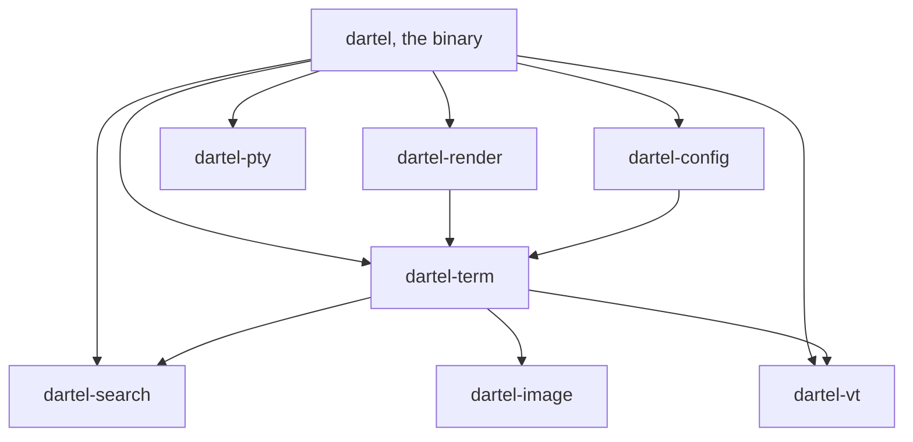
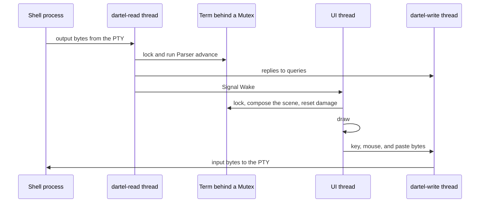
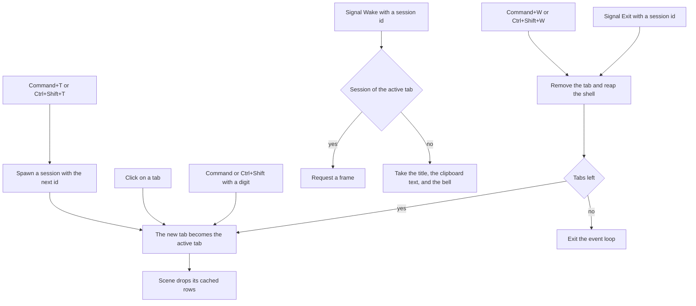
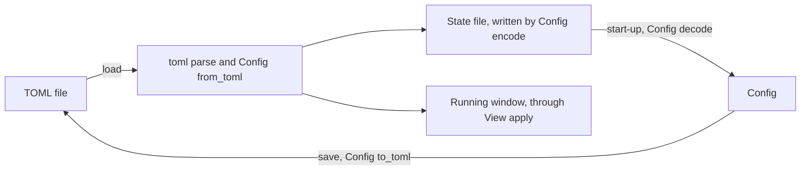
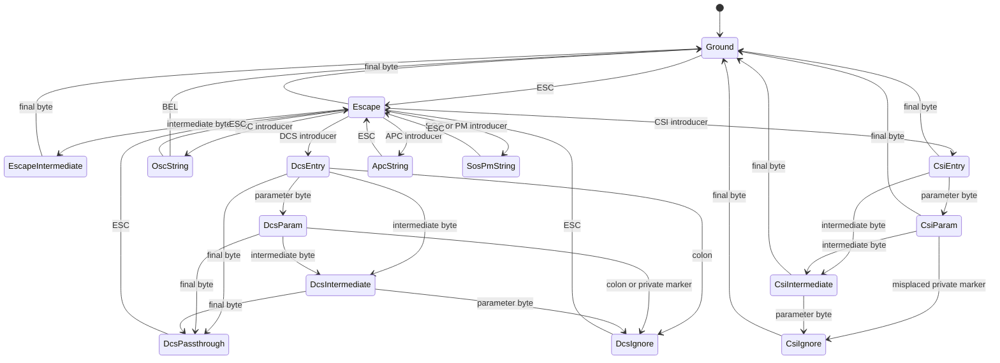
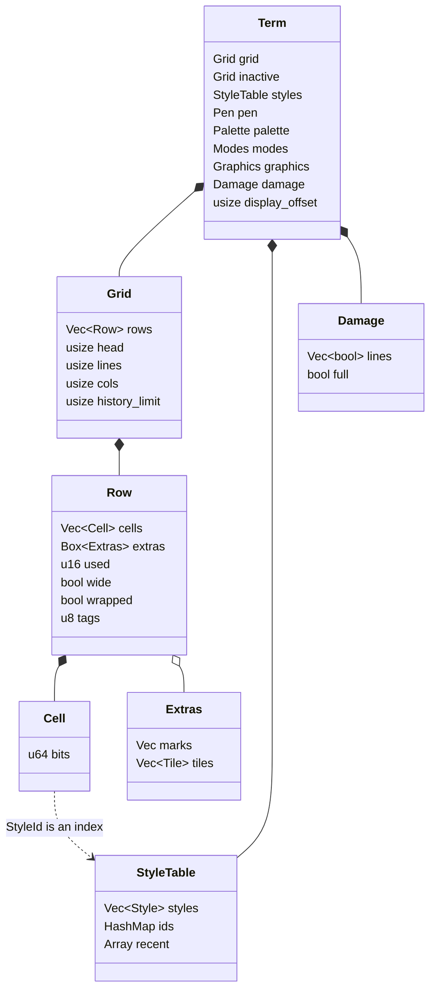
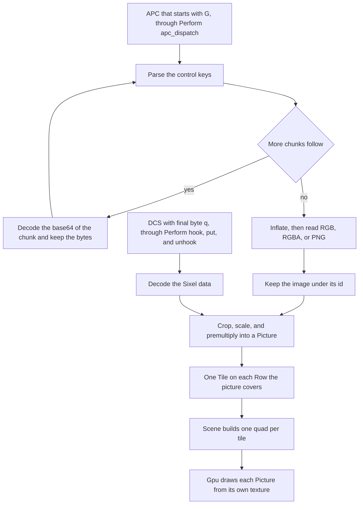
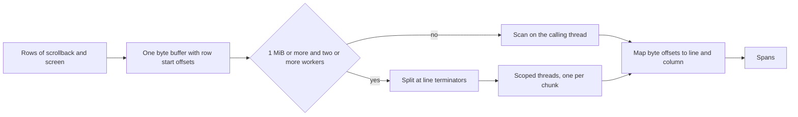
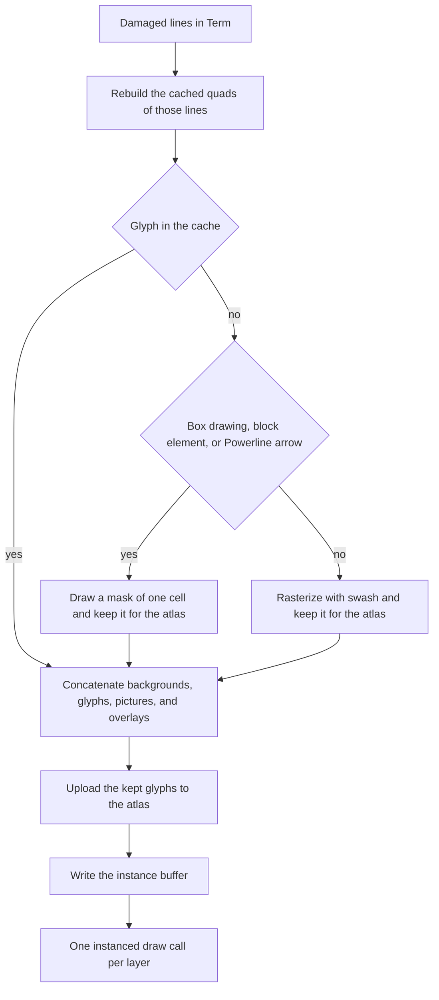

# Architecture

Dartel is a terminal emulator split into eight crates. Six library crates
turn the bytes a shell writes into terminal state and have no window or GPU
dependency. `dartel-render` draws that state with the GPU, and the `dartel`
binary owns the window, the tabs, and the input.

## Crates and modules

An arrow points from a crate to a crate it depends on.

| Crate | Modules | Responsibility |
| --- | --- | --- |
| `dartel-vt` | `lib`, `params`, `utf8`, `scan` | VT state machine that calls a `Perform` implementation, and the length of the leading run of printable ASCII with NEON, SSE2, and scalar implementations |
| `dartel-search` | `lib` | Literal and regex search over a byte buffer, and the URL around a byte offset |
| `dartel-image` | `lib`, `base64`, `inflate`, `png`, `sixel`, `scale` | Base64, zlib, PNG, and Sixel decoding into RGBA pixels, and scaling into premultiplied pixels |
| `dartel-term` | `lib`, `cell`, `grid`, `row`, `screen`, `perform`, `sgr`, `osc`, `style`, `color`, `find`, `graphics`, `keys`, `modes`, `charset` | Screen, scrollback, styles, modes, images, the kitty keyboard encoding, and the `Perform` implementation |
| `dartel-pty` | `lib` | PTY allocation, login shell spawn in a start directory, resize, hangup, and the host name |
| `dartel-config` | `lib`, `toml` | Settings, the TOML parser, the saved state, and the file locations |
| `dartel-render` | `scene`, `font`, `gpu` | Conversion of terminal rows into quads, the tab bar, the glyph cache, font discovery and rasterization, the wgpu surface, the picture textures, and the draw calls |
| `dartel` | `main`, `app`, `session`, `input`, `clipboard`, `opener` | The `config` and `shell` subcommands, the embedded shell integration scripts, winit event handling, tabs, selection, prompts, shortcuts, the threads around each PTY, key events, the clipboard, and the launch of links |

## Threads and data flow

Each tab owns one session, and one session runs three threads. The reader
thread parses output straight into the shared `Term`, so no byte is copied into
a channel between the PTY and the parser.

`Session` holds the state the threads share.

- `term` is the `Mutex<Term>`. The reader thread locks it for one read buffer
  at a time. The read buffer is 1 MiB. An image is decoded under this lock,
  when the last byte of its sequence arrives.
- `frame_waiting` is set by the UI thread while it waits for the lock. The
  reader thread yields while the flag is set, so a flood of output cannot
  starve a frame.
- `wake_pending` collapses wake-ups. The reader thread sends `Signal::Wake`
  only when the flag was clear, and the UI thread clears it when it starts a
  frame.

The UI thread sleeps in `ControlFlow::Wait`. It switches to
`ControlFlow::WaitUntil` only while a cursor blink, a synchronized-update
timeout, or a notice is pending. A frame is skipped while the application
holds synchronized update mode, for at most 150 ms.

A key press that is sent to the shell requests no frame by itself. The echo
comes back through the reader thread, and its `Signal::Wake` draws the one
frame that shows it. The key press requests a frame only when it changes
something on the UI thread: it clears a selection, returns a scrolled view to
the bottom, or restarts the blink while the cursor is hidden.

## Tabs

One window holds a list of tabs and draws the active one. A tab is a session
with its own title, selection, and search state. The window, the `Gpu`, and
the `Scene` are shared by all tabs.

- Every session has an id, and `Signal::Wake` and `Signal::Exit` carry it, so
  a signal finds its tab after other tabs have closed.
- A wake-up from a background tab draws no terminal content. The UI thread
  takes the title change, the clipboard request, and the bell from that `Term`
  and redraws only when the tab label changed.
- The tab bar is drawn while two or more tabs are open. It takes one cell
  height plus the padding at the top of the window, so opening the second tab
  and closing it resize every session.
- Every session is resized with the window, so a background tab has the right
  size when it becomes active.
- Closing a tab calls `Session::close`. The shell is reaped at once when it has
  exited. Otherwise its process group gets `SIGHUP`, and a `dartel-reap`
  thread waits for it.
- A new session starts in the directory that the shell of the active tab
  reported with OSC 7, when the host in the report is empty, `localhost`, or
  the name of this machine. `Term::directory` holds the report.
- `Session::spawn` and `Session::resize` pass the cell size in pixels to
  `Term::set_cell_size`, and the PTY window size carries the pixel size of the
  text area, so applications can size images.

## Settings

`dartel-config` holds the settings. The TOML file is read only when the user
asks for it, and the result is kept in a binary state file that start-up
decodes without parsing text.

- `toml::parse` is a single pass over the bytes of the input. Keys and
  unescaped strings borrow from the input. A table is a vector of entries in
  file order, and each entry records its line for error messages.
- The parser follows TOML 1.0 and reads tables, arrays of tables, dotted keys,
  inline tables, arrays, the four string forms, integers in four bases, floats,
  booleans, and date-times. A date-time is checked for its shape and the range
  of each field and is kept as text. Nesting is limited to 64 levels.
- The parser was run over the TOML 1.0 file list of toml-test, as packaged in
  `toml-test-data` 2.14.1. It accepts the 208 valid cases with the expected
  values and rejects the 501 invalid cases. The cases with invalid UTF-8 are
  rejected when the file is read as a string, before the parser runs. The
  corpus is not a dependency of this repository.
- `Config::from_toml` starts from the defaults and rejects an unknown key, a
  wrong type, and a value outside its range, each with the line number.
- `Config::encode` writes a magic that includes a format number, the fixed
  width fields in little-endian order, and the font family. `Config::decode`
  returns `None` for another magic, a short input, or a value outside its
  range, and start-up then uses the defaults.
- `Locations::resolve` places the TOML file under `XDG_CONFIG_HOME` and the
  state file under `XDG_STATE_HOME`, with `~/.config` and `~/.local/state` as
  fallbacks on both platforms.
- `save` and `load` are the only writers. The `dartel config save` and
  `dartel config load` subcommands and the two prompts in the window call the
  same functions.
- A load in the window rebuilds the `Scene` for the font and the padding, sets
  the palette of every `Term` through `Term::set_palette`, and resizes every
  session. The scrollback limit applies to tabs opened after the load, and the
  window size in cells applies at the next start.

## Parsing

`vt::Parser` is a byte-driven state machine. Most output is plain text, so the
`Ground` state has a bulk path. `scan::printable_run` returns the length of the
leading run of bytes in `0x20..=0x7E`, and the parser hands that whole run to
`Perform::print_ascii` in one call. `Ground` stays in one loop over the read
buffer while it sees text, C0 controls, and complete CSI sequences. A run of
multibyte characters is decoded into batches of up to 32 characters for
`Perform::print_chars`. `CsiEntry` and `CsiParam` read digits and separators
in one loop and leave every other byte to the single-byte step. Three string
states take their bytes in bulk too. `OscString` and `ApcString` copy their
payload into one buffer, and `DcsPassthrough` hands each run of data to
`Perform::put`. An application program command ends in `Perform::apc_dispatch`
with its whole payload. Every other state consumes one byte per step.

`CAN` and `SUB` return any state to `Ground`. `ESC` restarts a sequence from
any state.

UTF-8 is decoded by `vt::utf8`. An invalid sequence becomes one U+FFFD per
maximal subpart. A sequence cut by the end of a read buffer is kept in a
four-byte `pending` array and completed by the next `advance` call.

Limits keep hostile input bounded. A CSI sequence keeps 32 parameters and 2
intermediates. An OSC string keeps 16 parameters, and an OSC or APC string
keeps 16 MiB of payload.

## Terminal state

- `Cell` is one `u64`. The low 32 bits hold the code point, the next 16 hold
  the `StyleId`, and the bits above them are the flags for wide characters,
  the spacer cell after a wide character, and attached combining marks. The
  default cell is zero.
- `Row` stores combining marks outside the cells, as `(column, char)` pairs,
  with at most 8 marks per cell, and `tiles` holds the parts of images that
  the row shows. Both live in `Extras`. A row allocates it for its first mark
  or tile and frees it when both are empty, so `Row::extras` is `None` for a
  row of plain text and a `Row` is 40 bytes. `wrapped` records that the row
  continues on the next row, and `tags` holds the shell marks of the row.
- `Row::used` counts the leading cells that may differ from the default cell,
  so clearing a row and erasing to the end of a line write only those cells.
  `Row::wide` records that the row may hold a wide character. A write looks
  for a wide character to split only when `wide` is set and the write starts
  inside the used cells, and it looks at marks and tiles only when the row has
  `Extras`.
- `Grid` is a ring of rows, a `Vec<Row>` and the index `head` of its oldest
  row. The last `lines` rows are the screen and the rows before them are
  scrollback. When scrollback is full, a line feed at the bottom clears the
  oldest row and advances `head`, so that row becomes the last row without a
  move. Scrolling inside a region rotates that part of the `Vec`. A change to
  the number of rows first rotates the ring until `head` is zero.
- `Term` owns two grids, one for the primary screen and one for the alternate
  screen. `grid` is whichever is active and `inactive` is the other, and
  switching screens swaps them. The alternate grid keeps no scrollback.
- A `Color` is one `u32`. The top byte tells the default color, a palette
  index, and a direct color apart, and the low bytes hold the index or the
  three channels.
- `StyleTable` interns each distinct `Style`. The key joins the three colors,
  the attributes, and the link id into a `u128` without converting them. A
  `StyleId` is a `u16`, and when the table is full, `Term` rebuilds it from
  the styles that cells still reference. A direct-mapped array of 16 recent
  keys answers a repeated lookup before the hash map.
- `Pen` defers interning. SGR sequences only change `pen.style` and mark the
  pen as stale, and the style is interned when the next character is written.
- `Damage` marks the lines a frame has to rebuild. Scrolling the view or
  resizing sets `full`.

Printable ASCII takes a short path through `Term::write_ascii`. While insert
mode is off and the active character set is ASCII, a run is copied into the
row in one loop per line without a width lookup. Other characters arrive in
runs through `Term::write_chars`. Under the same two conditions it writes the
characters that end before the last column into the cursor row in one loop. A
character that needs a wrap, reaches the last column, or has no width goes
through `Term::write_char`, which handles width, wide characters at the right
margin, and combining marks. A range check decides the width of the common
CJK, Latin, Greek, Cyrillic, and box drawing characters before the
`unicode-width` table is read.

Resizing rewraps the primary screen when the column count changes. Rows joined
by `wrapped` are merged into logical lines and split again at the new width,
and the cursor follows its cell. The alternate screen is truncated or padded
instead, because full-screen applications redraw it themselves.

## Shell marks, links, and the working directory

- OSC 133 writes shell marks into `Row::tags`. `A` tags the cursor row as a
  prompt and `C` tags it as the start of output. `D` with an exit code other
  than 0 tags the nearest prompt row at or above the cursor as failed. A
  reflow moves the tags of a logical line to its first row, and the marks are
  ignored on the alternate screen.
- `Term::prompt_before`, `Term::prompt_after`, and `Term::last_output` read
  the tags for the prompt shortcuts and the copy of the last output. `Scene`
  draws a bar in palette color 9 in the left padding of a failed prompt row.
- OSC 7 stores the host and the percent-decoded path of a `file` URL, and
  `Term::directory` returns them.
- The scripts in `crates/dartel/shell` print these marks for zsh, bash, and
  fish. `include_str!` embeds them in the binary, and `dartel shell NAME`
  prints one. `Session::spawn` passes `std::env::current_exe` to
  `dartel_pty::login_shell`, which sets `DARTEL_BIN` to that path when it is
  absolute and removes the variable otherwise, so the line in a startup file
  finds the executable inside `Dartel.app`.
- Each script prints `A` from the hook that runs before the prompt and `C`
  from the hook that runs before a command: `precmd` and `preexec` in zsh,
  `PROMPT_COMMAND` and `PS0` in bash, and the `fish_prompt` and
  `fish_preexec` events in fish. The command hook sets a flag, and the
  prompt hook prints `D` with the exit status only while the flag is set, so
  an empty command line and the first prompt print no `D`. The prompt hook
  prints OSC 7 when `PWD` differs from the last reported directory. The path
  keeps ASCII letters, digits, and `/ . _ ~ -`, and every other byte becomes
  `%XX`. The host is `$HOST`, `$HOSTNAME`, or `$hostname`, which Dartel
  compares with the `uname` node name. bash prepends its hook to
  `PROMPT_COMMAND` so that `$?` is still the status of the command, and its
  `PS0` sets the flag through an arithmetic expression in a substring length
  that expands to nothing. A bash without `PS0` prints neither `C` nor `D`.
- OSC 8 interns the URI in a table of `Term` and stores its id in the `Style`,
  so a link adds no bytes to a cell. The table holds 65535 URIs of at most
  4096 bytes each, and `Scene` underlines the cells that carry a link id.
- `Term::target_at` resolves a point for a modified click. A cell with an OSC
  8 link gives that link when its scheme is `http`, `https`, `ftp`, `file`, or
  `mailto`, and nothing otherwise. Without a link, `dartel_search::url_at`
  looks for a URL around the point in the logical line, and the word under
  the point is the last candidate, as a path. `opener` runs `open` or
  `xdg-open` and waits for it on a `dartel-open` thread.
- `Term::text` copies a `Stream` selection and ends a row with `\n` unless it
  is `wrapped`. `Term::block_text` copies a `Block` selection, takes the
  columns of `Term::block_columns` from every row, and puts `\n` between rows.
  Both stop a row at its last occupied cell and keep combining marks with
  their cell.
- `Term::word_at` and `Term::line_at` give the spans of a double click and a
  triple click. A word ends at a space, a tab, or one of
  `` " ' ` ( ) [ ] { } < > | ; , ``.

## Keyboard protocol

`Term` keeps a stack of kitty keyboard flags for each screen, with at most 16
entries, and `Term::keyboard` returns the flags on top. `CSI > u` pushes,
`CSI < u` pops, `CSI = u` changes the top entry, and `CSI ? u` reports it.

`keys::encode` is the encoder and has no window dependency. It takes a
`Stroke`, which names the key, its shifted and base-layout forms, the text it
types, the modifiers, and whether it was pressed, repeated, or released, and
it returns bytes, `Legacy`, or `Nothing`. `input` in the binary builds the
`Stroke` from a winit event, and on `Legacy` it falls back to the encoding
used without the protocol. Caps Lock and Num Lock are not reported as
modifiers.

## Images

Sixel and the kitty graphics protocol end in the same structure. `dartel-image`
decodes the data into RGBA pixels, `Term` turns one placement into one
`Picture` and cuts it into tiles, one per row, and `Scene` turns each tile into
a quad.

- `dartel-image` has no dependency. `inflate` reads stored, fixed, and dynamic
  blocks and stops at an output limit. `png` checks the checksum of every
  chunk and reads every color type and bit depth, the five filters, and Adam7
  interlacing, and it keeps the high byte of 16-bit samples. `sixel` paints
  into rows that grow as the data moves right and down.
- A `Picture` is the premultiplied RGBA pixels of one placement at its display
  size, with a serial number that orders the pictures of one `Term`.
  `Image::premultiplied` crops the source rectangle and scales it by averaging
  the source pixels under each output pixel.
- A `Tile` is the part of a `Picture` that one row shows. It holds the first
  column, the offset inside the cell, the source rectangle, and the cell size
  at placement. Tiles live in `Row`, so scrolling, the scrollback limit, and
  reflow move and drop them with their row.
- Tiles of the kitty protocol stay when cells are written or erased, and
  `Row::clear`, which the partial forms of erase display use, keeps them.
  Sixel tiles are fragile. `Row::release` cuts the written columns out of
  them, and `Row::clear` drops them. `Row::reset`, which runs when a row is
  recycled or the whole screen is cleared, drops every tile.
- A kitty placement moves the cursor as kitty does, right by the columns of
  the placement and down to its last row. The protocol text says down by the
  number of rows. A Sixel image leaves the cursor on the row below the image,
  in the column where the image started.
- Each chunk of a kitty transfer is decoded from base64 on its own, because
  chafa pads every chunk. A transfer keeps at most the bytes of one image of
  4096 by 4096 pixels.
- `Term` keeps the transmitted images by id, the newest id for each image
  number, and a weak reference to every placed `Picture`. Both sets are held
  to 256 MiB by dropping the oldest entries.
- Replies to graphics commands and to `CSI 14 t` and `CSI 16 t` go through the
  reply buffer that other queries use. The window sets the cell size with
  `Term::set_cell_size`.
- Animation, Unicode placeholders, relative placements, the indexed formats,
  and transmission through files or shared memory are refused, with an
  `EINVAL` reply when the command names an image. `umt_from_base64` returns a
  UTF-8 string, so image payloads are decoded by `dartel_image::base64`
  instead.

## Search

`Term::search` flattens scrollback and screen into one byte buffer. A row that
is not `wrapped` ends with `\n`, so a match can cross a soft wrap and cannot
cross a hard line break. Byte offsets of matches are mapped back to line and
column, which accounts for wide characters and combining marks.

`search::Query` picks its engine once. A query with no regex metacharacter
and no case folding uses `memchr::memmem::Finder`. Everything else compiles to
`regex::bytes::Regex` in multi-line mode. Smart case folds only when the query
has no uppercase letter.

## Rendering

`Scene` converts rows into `Quad` instances. A `Quad` is 20 bytes and holds a
pixel rectangle, a texture rectangle, and a color. A frame without images is
one instanced draw call over a four-vertex triangle strip. A frame with images
draws the text, each picture from its own texture, and the overlays in
separate calls over ranges of the same instance buffer.

- `Scene` caches the background quads and glyph quads of each line. A frame
  rebuilds only the lines that `Damage` reports.
- Overlays are appended after the cached quads on every frame. They are search
  matches, the selection, the scroll position bar, the cursor, the banner on
  the last line, the IME preedit text, and the tab bar. The banner shows the
  search prompt, a settings prompt, or a notice, and keeps the end of a text
  that is wider than the window.
- The scroll position bar is one quad on the right edge of the window, drawn
  only while the view is scrolled back. Its length is the share of all rows
  that the screen shows, at least one cell, and its position follows the first
  visible row.
- The cached quads of the lines start below the tab bar. Showing or hiding the
  bar marks every line stale.
- `Scene` keeps the picture quads of each line beside its background and glyph
  quads. A frame appends them after the glyphs, ordered by serial number, and
  lists the quads as layers: the text, one layer for each run of quads that
  share a `Picture`, and the overlays. `Gpu::draw` binds the atlas or the
  texture of the picture for each layer and draws its range of instances.
- `Gpu` creates the texture of a `Picture` when a frame first uses it. The key
  is the address of the `Arc<Picture>`, because serial numbers repeat across
  tabs. A texture is dropped when its `Picture` is gone, or when the textures
  pass 256 MiB and the frame does not use it. A picture larger than the
  texture limit of the device is not drawn.
- The texture rectangle of a quad has an origin and a size, and a size of zero
  marks a solid quad. A tile placed at another cell size is drawn scaled, from
  the nearest texel.
- The glyph atlas is one 2048 by 2048 RGBA texture filled shelf by shelf.
  `Scene` picks the place of a new glyph and keeps its pixels until
  `Scene::flush` uploads them, so `Scene::compose` takes no `Gpu`, and the
  upload runs after the UI thread has released the `Term`. When the atlas is
  full, the glyph cache and the kept pixels are dropped and the visible lines
  are rasterized again.
- `cargo bench -p dartel-render --bench compose` times `Scene::compose`
  without a window. It fills a `Term` with generated lines and measures a
  frame that rebuilds every line, a frame after one new line, and a frame
  after no change.
- Straight and double underlines are solid quads. Curly, dotted, and dashed
  underlines are masks one cell wide that `Scene` draws into the atlas on
  first use, one per pattern, and every underlined cell gets one textured quad
  tinted with the underline color. The curly mask holds one period of a
  cosine wave and the dotted and dashed masks repeat a whole number of times,
  so neighboring cells join without a seam. The mask starts at the underline
  position and moves up when it would pass the bottom of the cell. The masks
  are dropped with the glyph cache, so a full atlas or a new font size draws
  them again.
- Box drawing characters from U+2500 to U+257F, block elements from U+2580
  to U+259F, and the Powerline arrows from U+E0B0 to U+E0B3 are not taken
  from the font. When such a character is first rasterized, `Scene` draws a
  mask the size of one cell into the atlas and caches it as a glyph whose
  left edge, top, and advance put it on the top left corner of the cell. From
  then on it goes through the glyph cache and `Scene::compose_row` like any
  other glyph, so the check costs nothing per cell. The masks come from a pure
  function of the code point, the cell size, and `Metrics::stroke`.
- A box drawing character is described by the weight of its four arms, none,
  light, heavy, or double, read from a table of four digits per character.
  A light line is `Metrics::stroke` thick, a heavy line is twice that or a
  fifth of the cell width, and the gap of a double line is the light stroke or
  an eighth of the cell width. Horizontal lines are centered on the height of
  the cell and vertical lines on its width, with the same integer rounding for
  every character, so an arm meets the edge of the cell on the same pixels as
  the straight line of its weight in the next cell. Each arm runs from the
  edge into the perpendicular lines, and the lines of a double arm stop at
  the near or far line of a double crossing depending on which arms exist, so
  double corners and tees keep their inner gaps. Dashed lines clear a whole
  number of gaps that split evenly at the cell edges. Rounded corners are a
  quarter circle that ends one pixel before the edge and continues as a
  straight line, and diagonals run from corner to corner. Curves and slopes
  are antialiased by their distance to the line.
- Block elements fill rectangles in eighths of the cell, with at least one
  pixel, and the shades are the whole cell at a quarter, a half, and three
  quarters of full alpha. The Powerline arrows are a filled triangle and its
  outline one light stroke wide, mirrored for the left-pointing pair.
- Glyphs for ASCII are cached in an array indexed by face and byte. Other
  glyphs are cached in a `HashMap` keyed by character and face.
- `font::Fonts` loads four faces of one family and finds a fallback face per
  character on first use. The family is the one in the settings when it is
  installed, and the platform list otherwise. Color glyphs are stored
  premultiplied.
- The fragment shader reads the bound texture with `textureLoad`, so no
  sampler is bound. The surface uses a non-sRGB format and premultiplied alpha
  blending.

## Input

- `input::encode` turns a key event into bytes. While kitty keyboard flags are
  set it asks `keys::encode` first, and otherwise it uses the terminal modes
  for application cursor keys. A key release is encoded only for that
  protocol.
- Shortcuts are handled before encoding and use Command on macOS and
  Ctrl+Shift on Linux. They are paste, copy, the copy of the last output,
  search, the prompt jumps, a new tab, closing a tab, tab selection, the font
  size, and the two settings prompts. Tab selection and the font size match
  the physical key, so they do not depend on the keyboard layout.
- A press with the shortcut modifier opens the target under the pointer. Two
  and three presses on one cell within 500 ms select a word and a line.
- A selection is a `Selection`, either `Stream`, which follows the text from
  one point to another, or `Block`, a rectangle. A drag that starts with Alt
  held, which is Option on macOS, makes a `Block` whose `Span` comes from
  `Span::block` and holds the top left and the bottom right cells.
  `Term::block_columns` widens the columns of a row over a wide character that
  either side cuts, and `Scene` draws one quad per row from it.
- A settings prompt takes keys before the search prompt, and the search prompt
  takes them before the shell.
- Mouse events are reported to the application when it enabled a mouse mode,
  in SGR or X10 encoding. Holding Shift keeps the event for local selection.
- A press on the tab bar selects a tab and is never reported or used for
  selection, and neither is its release.
- When the application enabled bracketed paste, paste removes `ESC` from the
  text and wraps it in the markers. Otherwise it converts line breaks to
  carriage returns.
- IME preedit text is drawn at the cursor and is never sent to the shell.
  Committed text is sent as is.

## Platform differences

| Concern | Apple Silicon macOS | x86_64 Linux |
| --- | --- | --- |
| Printable ASCII scan | NEON | SSE2 |
| wgpu backend | Metal | Vulkan or GLES |
| Default font family | Menlo, then Monaco | DejaVu Sans Mono, then Liberation Mono |
| Clipboard | `pbpaste`, `pbcopy` | `wl-paste` and `wl-copy`, then `xclip` |
| Shortcut modifier | Command | Ctrl+Shift |
| Opener for links | `open` | `xdg-open` |
| Meta key | Left Option | Alt |
| Rectangle selection modifier | Option | Alt |
| Default shell without `SHELL` | `/bin/zsh` | `/bin/sh` |
| Search workers | At most 6 | All available cores |

## Designs taken from happy-cracking and umt_rust

The search foundation of happy-cracking lives in a `pub(crate)` module, so
Dartel cannot depend on it. These designs were rewritten for Dartel instead.

| happy-cracking source under `src/hc_internal/` | Dartel use |
| --- | --- |
| Bitmask scans in `grep/searcher/bitcount.rs` | `dartel_vt::scan::printable_run` |
| Maximal-subpart UTF-8 decoding in `grep/bytes.rs` | `utf8` in `dartel-vt` |
| Literal fast path in `grep/regex/literal.rs` | `dartel_search::Query` engine selection |
| Line-aligned chunks in `grep/searcher/parallel.rs` | `dartel_search::find_all` |
| Thread cap of 6 on macOS in `walker/walk.rs` | `dartel-search` worker count |

`umt_rust` is a direct dependency of `dartel-term`. `umt_hexa_to_rgba` parses
OSC color specifications and the colors of the settings file, and
`umt_from_base64` decodes OSC 52 clipboard payloads.
