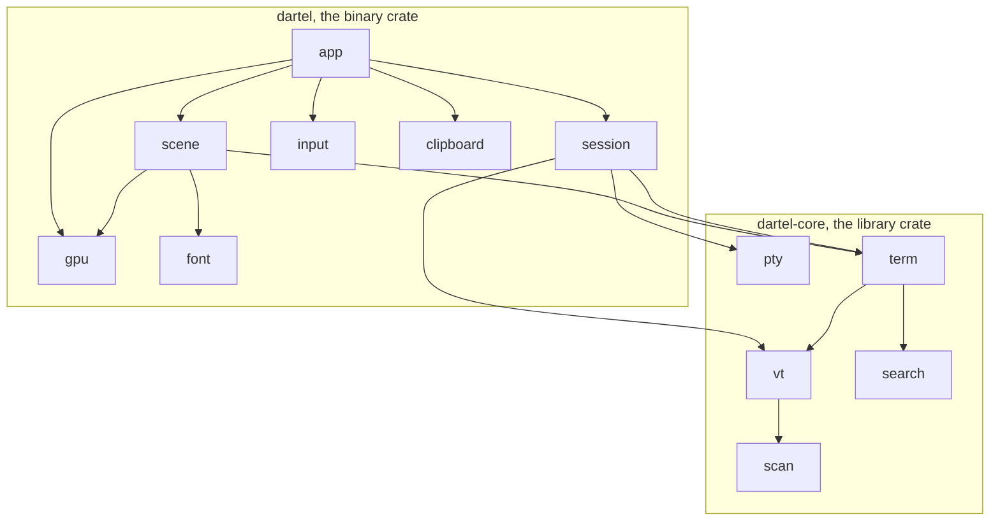
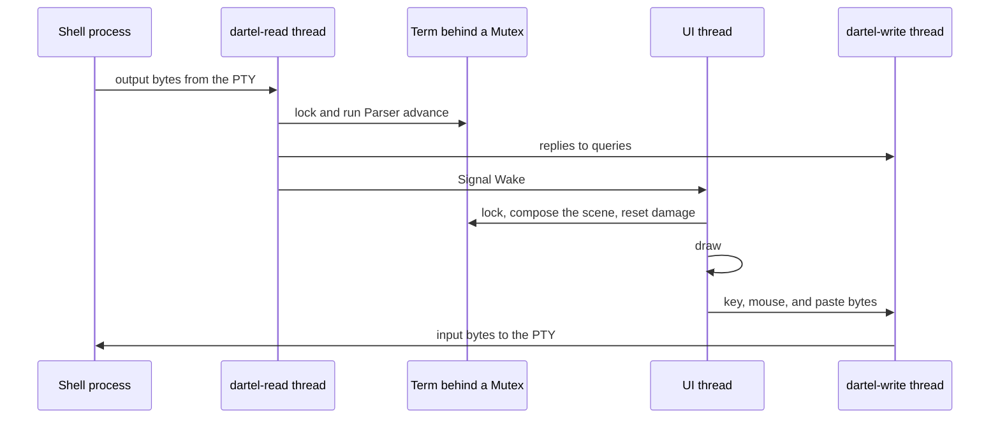
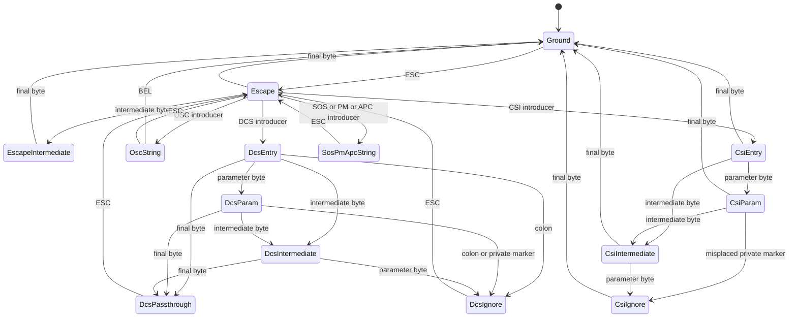
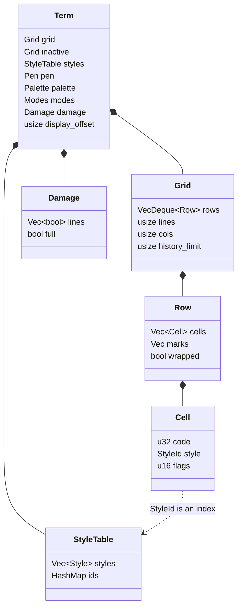
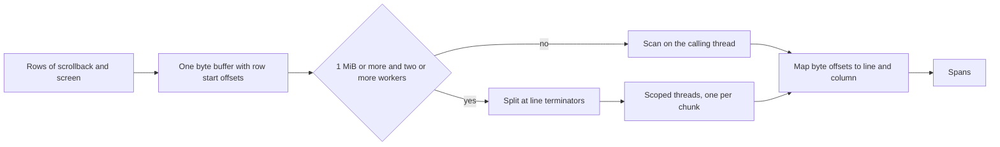
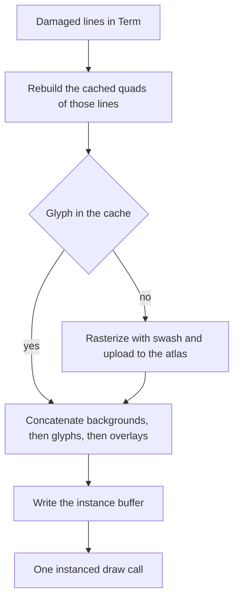

# Architecture

Dartel is a terminal emulator split into two crates. `dartel-core` turns the
bytes a shell writes into terminal state and has no window or GPU dependency.
`dartel` owns the window, draws that state with the GPU, and turns input events
back into bytes.

## Crates and modules

| Module | Crate | Responsibility |
| --- | --- | --- |
| `scan` | `dartel-core` | Length of the leading run of printable ASCII, with NEON, SSE2, and scalar implementations |
| `vt` | `dartel-core` | VT state machine that calls a `Perform` implementation |
| `term` | `dartel-core` | Screen, scrollback, styles, modes, and the `Perform` implementation |
| `search` | `dartel-core` | Literal and regex search over a byte buffer |
| `pty` | `dartel-core` | PTY allocation, login shell spawn, resize |
| `session` | `dartel` | Reader and writer threads around one PTY and one `Term` |
| `app` | `dartel` | winit event handling, selection, search prompt, shortcuts |
| `scene` | `dartel` | Conversion of terminal rows into quads, glyph cache |
| `font` | `dartel` | Font discovery, fallback, rasterization |
| `gpu` | `dartel` | wgpu surface, glyph atlas texture, the draw call |
| `input` | `dartel` | Key event to byte sequence encoding |
| `clipboard` | `dartel` | Clipboard access through the platform commands |

## Threads and data flow

One session runs three threads. The reader thread parses output straight into
the shared `Term`, so no byte is copied into a channel between the PTY and the
parser.

`Session` holds the state the threads share.

- `term` is the `Mutex<Term>`. The reader thread locks it for one read buffer
  at a time. The read buffer is 1 MiB.
- `frame_waiting` is set by the UI thread while it waits for the lock. The
  reader thread yields while the flag is set, so a flood of output cannot
  starve a frame.
- `wake_pending` collapses wake-ups. The reader thread sends `Signal::Wake`
  only when the flag was clear, and the UI thread clears it when it starts a
  frame.

The UI thread sleeps in `ControlFlow::Wait`. It switches to
`ControlFlow::WaitUntil` only while a cursor blink or a synchronized-update
timeout is pending. A frame is skipped while the application holds
synchronized update mode, for at most 150 ms.

## Parsing

`vt::Parser` is a byte-driven state machine. Most output is plain text, so the
`Ground` state has a bulk path. `scan::printable_run` returns the length of the
leading run of bytes in `0x20..=0x7E`, and the parser hands that whole run to
`Perform::print_ascii` in one call. The `OscString` state also copies its
payload in bulk. Every other state consumes one byte per step.

`CAN` and `SUB` return any state to `Ground`. `ESC` restarts a sequence from
any state.

UTF-8 is decoded by `vt::utf8`. An invalid sequence becomes one U+FFFD per
maximal subpart. A sequence cut by the end of a read buffer is kept in a
four-byte `pending` array and completed by the next `advance` call.

Limits keep hostile input bounded. A CSI sequence keeps 32 parameters and 2
intermediates. An OSC string keeps 16 parameters and 16 MiB of payload.

## Terminal state

- `Cell` is 8 bytes. It stores the code point, a `StyleId`, and flags for
  wide characters, the spacer cell after a wide character, and attached
  combining marks.
- `Row` stores combining marks outside the cells, as `(column, char)` pairs,
  with at most 8 marks per cell. `wrapped` records that the row continues on
  the next row.
- `Grid` is a `VecDeque<Row>`. The last `lines` rows are the screen and the
  rows before them are scrollback. When scrollback is full, the oldest row is
  popped and reused as the new blank row.
- `Term` owns two grids, one for the primary screen and one for the alternate
  screen. `grid` is whichever is active and `inactive` is the other, and
  switching screens swaps them. The alternate grid keeps no scrollback.
- `StyleTable` interns each distinct `Style`. The key packs the three colors
  and the attributes into a `u128`. A `StyleId` is a `u16`, and when the table
  is full, `Term` rebuilds it from the styles that cells still reference.
- `Pen` defers interning. SGR sequences only change `pen.style`, and the style
  is interned when the next character is written.
- `Damage` marks the lines a frame has to rebuild. Scrolling the view or
  resizing sets `full`.

Printable ASCII takes a short path through `Term::write_ascii`. While insert
mode is off and the active character set is ASCII, a run is copied into the
row in one loop per line without a width lookup. Other characters go through
`Term::write_char`, which handles width, wide characters at the right margin,
and combining marks.

Resizing rewraps the primary screen when the column count changes. Rows joined
by `wrapped` are merged into logical lines and split again at the new width,
and the cursor follows its cell. The alternate screen is truncated or padded
instead, because full-screen applications redraw it themselves.

## Search

`Term::search` flattens scrollback and screen into one byte buffer. A row that
is not `wrapped` ends with `\n`, so a match can cross a soft wrap and cannot
cross a hard line break. Byte offsets of matches are mapped back to line and
column, which accounts for wide characters and combining marks.

`search::Query` picks its engine once. A query with no regex metacharacter
and no case folding uses `memchr::memmem::Finder`. Everything else compiles to
`regex::bytes::Regex` in multi-line mode. Smart case folds only when the query
has no uppercase letter.

## Rendering

`Scene` converts rows into `Quad` instances. A `Quad` is 20 bytes and holds a
pixel rectangle, an atlas origin, and a color. The whole frame is one
instanced draw call over a four-vertex triangle strip.

- `Scene` caches the background quads and glyph quads of each line. A frame
  rebuilds only the lines that `Damage` reports.
- Overlays are appended after the cached quads on every frame. They are search
  matches, the selection, the cursor, the search prompt, and the IME preedit
  text.
- The glyph atlas is one 2048 by 2048 RGBA texture filled shelf by shelf. When
  it is full, the glyph cache is dropped and the visible lines are rasterized
  again.
- Glyphs for ASCII are cached in an array indexed by face and byte. Other
  glyphs are cached in a `HashMap` keyed by character and face.
- `font::Fonts` loads four faces of one family and finds a fallback face per
  character on first use. Color glyphs are stored premultiplied.
- The fragment shader reads the atlas with `textureLoad`, so no sampler is
  bound. The surface uses a non-sRGB format and premultiplied alpha blending.

## Input

- `input::encode` turns a key event into bytes, using the terminal modes for
  application cursor keys.
- Shortcuts are handled before encoding. Paste, copy, and search use Command
  on macOS and Ctrl+Shift on Linux.
- Mouse events are reported to the application when it enabled a mouse mode,
  in SGR or X10 encoding. Holding Shift keeps the event for local selection.
- When the application enabled bracketed paste, paste removes `ESC` from the
  text and wraps it in the markers. Otherwise it converts line breaks to
  carriage returns.
- IME preedit text is drawn at the cursor and is never sent to the shell.
  Committed text is sent as is.

## Platform differences

| Concern | Apple Silicon macOS | x86_64 Linux |
| --- | --- | --- |
| Printable ASCII scan | NEON | SSE2 |
| wgpu backend | Metal | Vulkan or GLES |
| Primary font | Menlo, then Monaco | DejaVu Sans Mono, then Liberation Mono |
| Clipboard | `pbpaste`, `pbcopy` | `wl-paste` and `wl-copy`, then `xclip` |
| Shortcut modifier | Command | Ctrl+Shift |
| Meta key | Left Option | Alt |
| Default shell without `SHELL` | `/bin/zsh` | `/bin/sh` |
| Search workers | At most 6 | All available cores |

## Designs taken from happy-cracking and umt_rust

The search foundation of happy-cracking lives in a `pub(crate)` module, so
Dartel cannot depend on it. These designs were rewritten for Dartel instead.

| happy-cracking source under `src/hc_internal/` | Dartel use |
| --- | --- |
| Bitmask scans in `grep/searcher/bitcount.rs` | `scan::printable_run` |
| Maximal-subpart UTF-8 decoding in `grep/bytes.rs` | `vt::utf8` |
| Literal fast path in `grep/regex/literal.rs` | `search::Query` engine selection |
| Line-aligned chunks in `grep/searcher/parallel.rs` | `search::find_all` |
| Thread cap of 6 on macOS in `walker/walk.rs` | `search` worker count |

`umt_rust` is a direct dependency. `umt_hexa_to_rgba` parses OSC color
specifications and `umt_from_base64` decodes OSC 52 clipboard payloads.
